<!--
  📸 IMAGE SLOTS
  Every picture in this README already has a placeholder file.
  To fill a slot: replace the file and keep the SAME NAME. That's it.
  Want a GIF where a PNG is used (or the other way round)? Change the file extension in this README.

    docs/screenshots/hero.png ............ your best desktop shot      (1920x1080)
    docs/screenshots/demo-switch.gif ..... a theme switch, recorded    (1280x720)
    docs/screenshots/installer.gif ....... the installer, recorded     (1280x720)
    docs/screenshots/bar-strip.gif ....... the thin bar, close up      (1600x200)
    docs/screenshots/themes/NAME.png ..... one per theme, 9 in total   (1280x720)
    docs/screenshots/gui/PAGE.png ........ control center, 9 in total  (1280x800)

  docs/assets/banner.png is your own banner. theme-cycle, how-it-works, palette and divider are
  drawn in the same style, so the whole page looks like one thing.
-->

<div align="center">

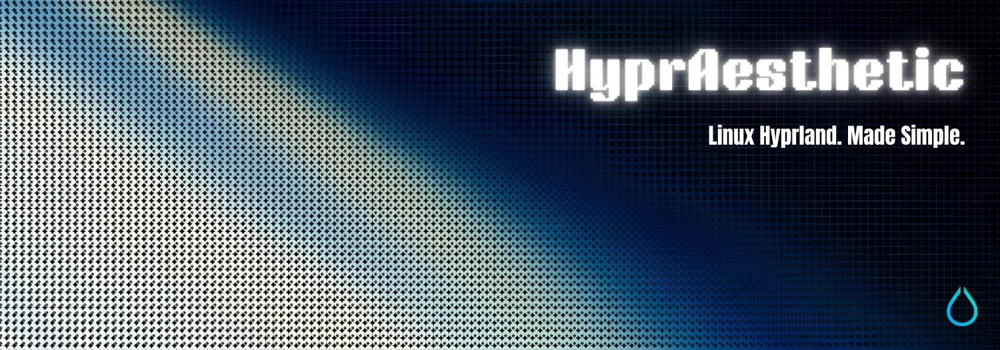

<br>

**Re-skin your whole Hyprland desktop with one command.**

An installer, theme packs and a control center, all in one. Hyprland only.

<br>

<a href="https://github.com/TheLinuxGuy-ssh/HyprAesthetic/stargazers"></a>
<a href="LICENSE"></a>
<a href="https://www.python.org/downloads/"></a>
<a href="https://github.com/TheLinuxGuy-ssh/HyprAesthetic/actions"></a>


<br><br>

<b>
<a href="#quick-start">Quick start</a> &nbsp;·&nbsp;
<a href="#themes">Themes</a> &nbsp;·&nbsp;
<a href="#bars">Bars</a> &nbsp;·&nbsp;
<a href="#control-center">Control center</a> &nbsp;·&nbsp;
<a href="#how-it-works">How it works</a> &nbsp;·&nbsp;
<a href="#keybinds">Keybinds</a> &nbsp;·&nbsp;
<a href="#make-a-theme">Make a theme</a> &nbsp;·&nbsp;
<a href="#faq">FAQ</a>
</b>

</div>

<br>

<p align="center">
  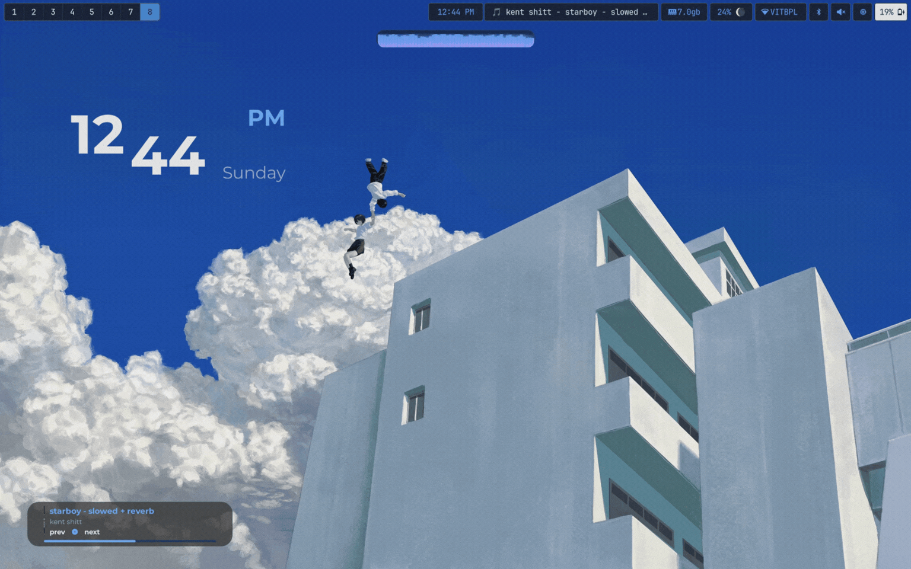
</p>

<p align="center">
  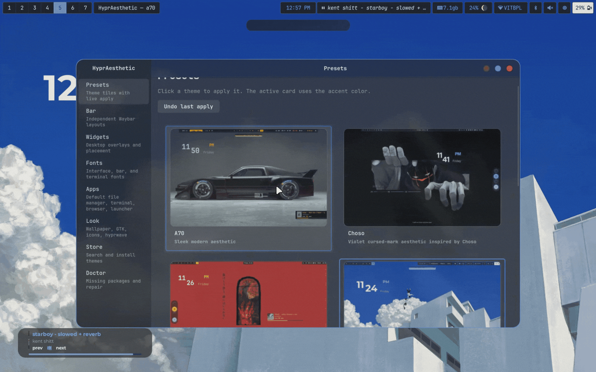
  <br>
  <sub><b>↑ Same desktop. Different theme. One command each time.</b></sub>
</p>


<a id="what-is-it"></a>

## So… what is this?

**HyprAesthetic** makes [Hyprland](https://github.com/hyprwm/Hyprland) look amazing. And it keeps things easy.

Linux folks call this **"ricing"**: tuning how your desktop looks. It is fun. But a normal rice is a big pile of config files. Change one color and you may need to edit ten files.

HyprAesthetic fixes that. You get **themes**. A theme is a tiny folder. Switch it, and your whole desktop follows.

```diff
- Copy files into lots of config folders
- Edit the same colors again and again
- Break something. Lose your whole evening.
+ hat switch spartan
```

<p align="center">
  
  <br>
  <sub>An illustration of what one command does. Real screenshots are further down.</sub>
</p>

<table>
  <tr>
    <td width="33%" valign="top">
      <h3>One command</h3>
      Type <code>hat switch &lt;theme&gt;</code>. Your windows, bar, widgets, launcher, terminal, notifications and apps all change together.
    </td>
    <td width="33%" valign="top">
      <h3>Tiny themes</h3>
      A theme is 16 colors, a wallpaper and a preview image. No more copying 200 files just to try a new palette.
    </td>
    <td width="33%" valign="top">
      <h3>Click or type</h3>
      Like terminals? Use <code>hat</code>. Not yet? Open the control center and click a tile.
    </td>
  </tr>
</table>

<a id="quick-start"></a>

## Quick start

**Full install (packages + configs):**

```bash
sudo pacman -S git      # Arch family. On other distros, install git your usual way
git clone https://github.com/TheLinuxGuy-ssh/HyprAesthetic
cd HyprAesthetic
./autoinstall.sh
```

**Dotfiles only (configs only, no packages):**

```bash
git clone https://github.com/TheLinuxGuy-ssh/HyprAesthetic
cd HyprAesthetic
./autoinstall.sh --dotfiles
```

The installer asks a few questions, installs what you need, **backs up your old configs first**, and applies a theme. First time with Hyprland? Log out, then pick **Hyprland** on your login screen.

Run it as a normal user with sudo. If you run it as root, it warns you and asks before it goes on. On Arch and CachyOS it uses yay or paru for AUR packages, and you pick which one.

> **Use `--dotfiles`** if you're on an unsupported distro, want to manage packages yourself, or just want to deploy configs without installing anything.

<p align="center">
  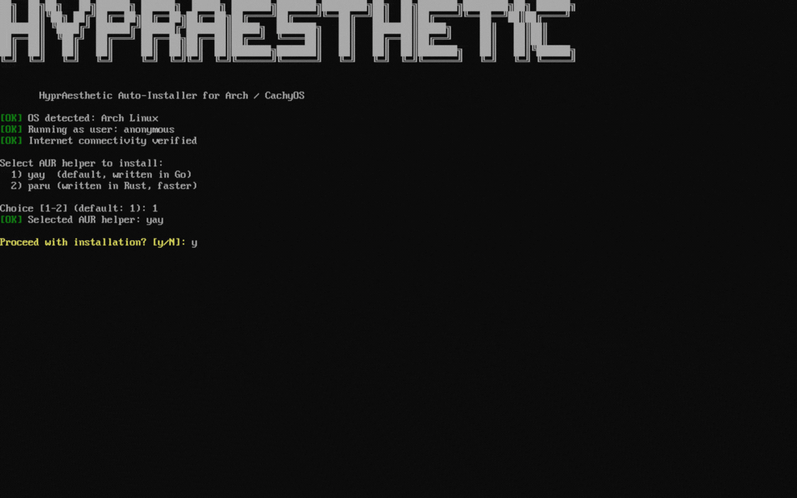
  <br>
  <sub><b>↑ The installer, start to finish.</b></sub>
</p>

**Works on: (excluding autoinstall script)**


> [!NOTE]
> HyprAesthetic is for **Hyprland only**.

Now play with it:

```bash
hat gui                # open the control center
hat list               # see every theme
hat switch spartan     # change your whole desktop
```

> [!TIP]
> Not sure yet? Add `--dry-run` to see what would change, without changing anything:
> `hat switch spartan --dry-run`

<details>
<summary><b>🔍 What does the installer do?</b></summary>

<br>

It has two modes:

| | Default | Dotfiles (--dotfiles) |
|---|---|---|
| **Good for** | "Install Everything" | "I just need the config files" |
| **You get** | Package Installation + Dotfiles | Dotfiles only |

</details>


<a id="themes"></a>

## Themes: proof, not promises

These themes come in the box. Click one in the control center, or type its name.

<table>
  <tr>
    <td align="center" width="33%">
      <a href="themes/toji/toji.png">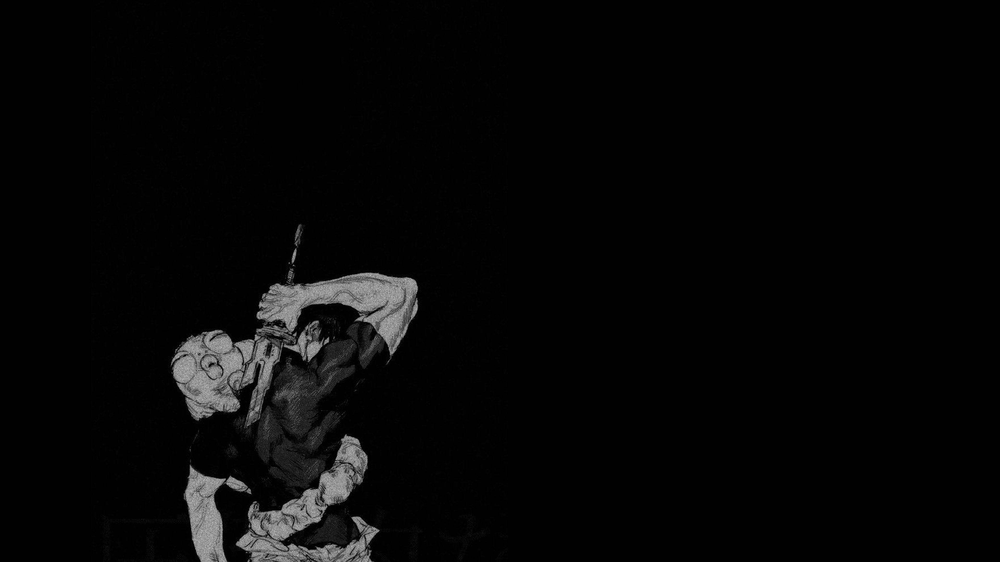</a><br>
      <b>toji</b><br>
      <code>hat switch toji</code>
    </td>
    <td align="center" width="33%">
      <a href="themes/toji_2/toji_red.png">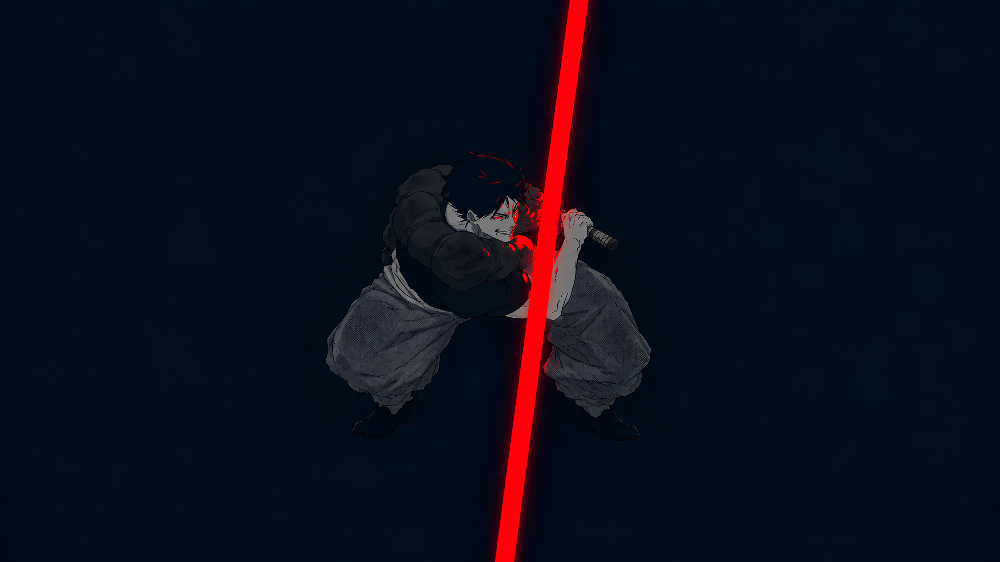</a><br>
      <b>toji_2</b><br>
      <code>hat switch toji_2</code>
    </td>
    <td align="center" width="33%">
      <a href="themes/a70/a70.png">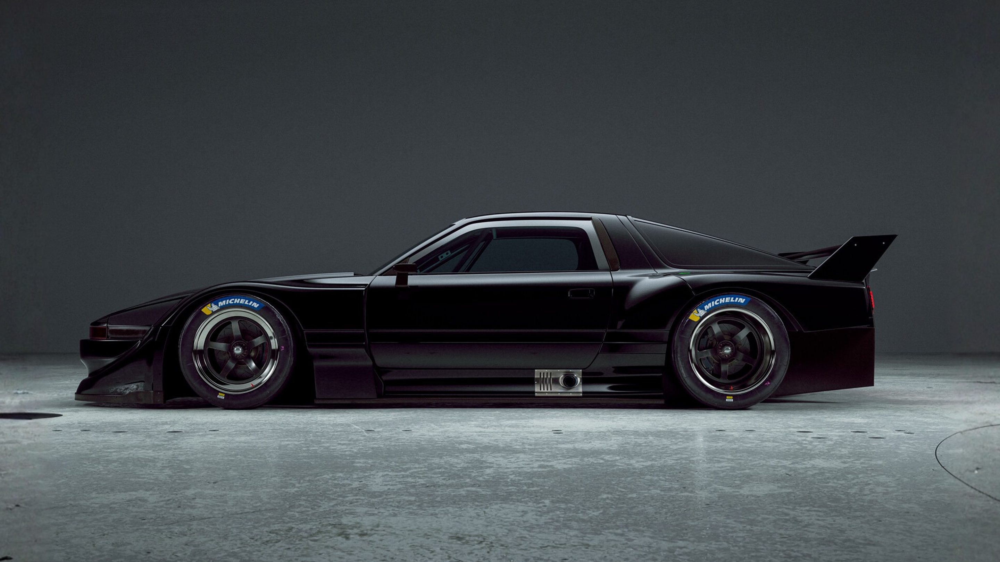</a><br>
      <b>a70</b><br>
      <code>hat switch a70</code>
    </td>
  </tr>
  <tr>
    <td align="center" width="33%">
      <a href="themes/spartan/spartan.png">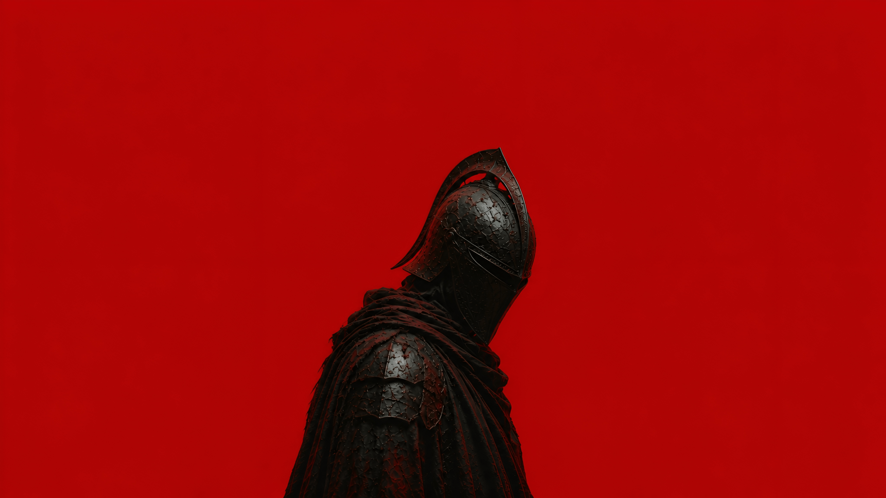</a><br>
      <b>spartan</b><br>
      <code>hat switch spartan</code>
    </td>
    <td align="center" width="33%">
      <a href="themes/choso/choso.png">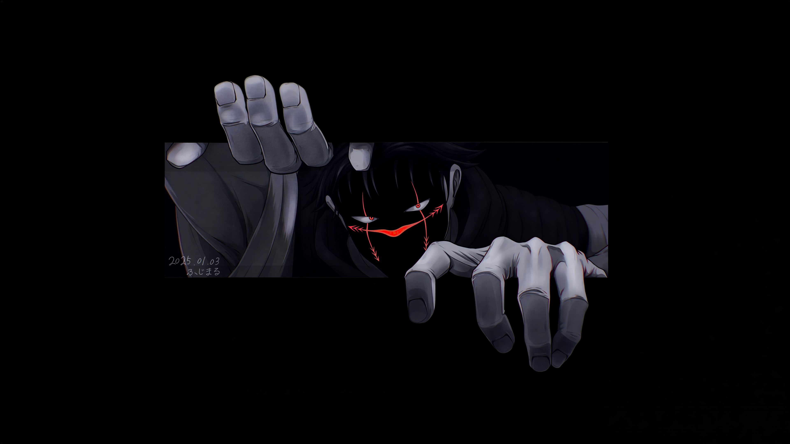</a><br>
      <b>choso</b><br>
      <code>hat switch choso</code>
    </td>
    <td align="center" width="33%">
      <a href="themes/jjk/jjk.png">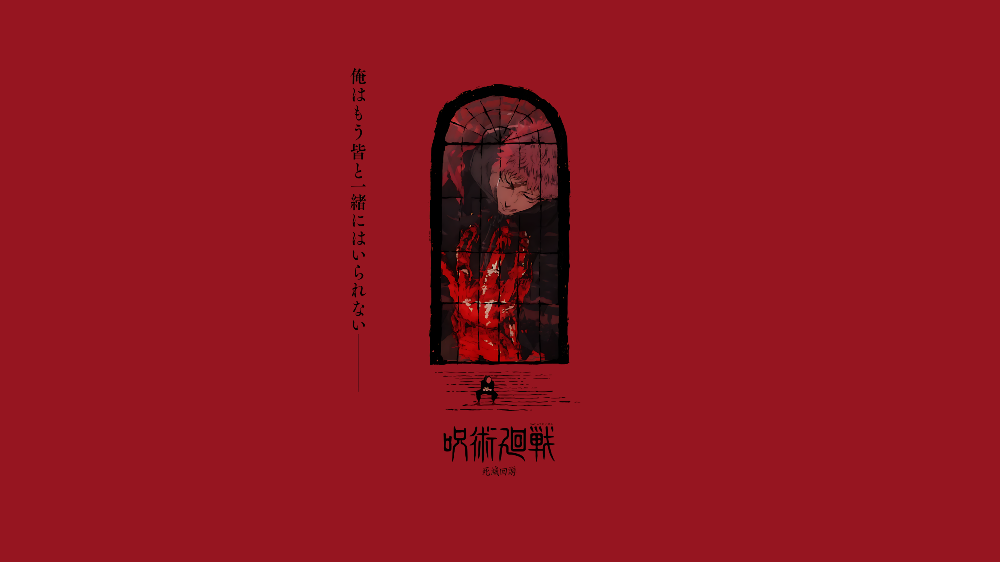</a><br>
      <b>jjk</b><br>
      <code>hat switch jjk</code>
    </td>
  </tr>
  <tr>
    <td align="center" width="33%">
      <a href="themes/sky/sky.png"></a><br>
      <b>sky</b><br>
      <code>hat switch sky</code>
    </td>
    <td align="center" width="33%">
      <a href="themes/tanjiro/tanjiro.png">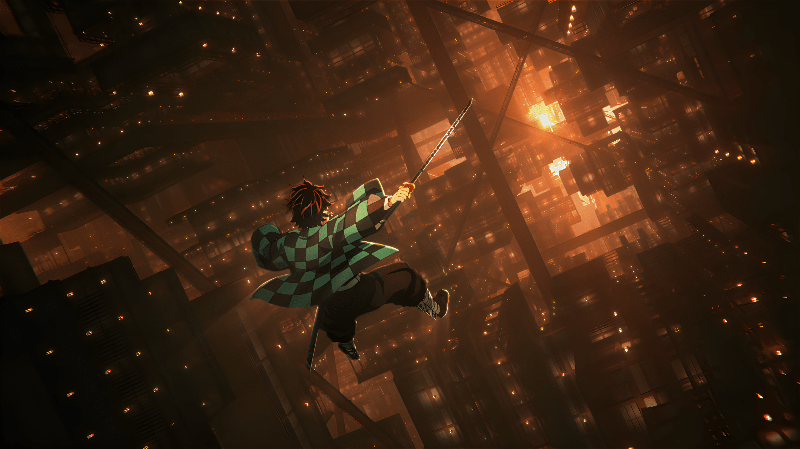</a><br>
      <b>tanjiro</b><br>
      <code>hat switch tanjiro</code>
    </td>
    <!-- <td align="center" width="33%">
      <a href="docs/screenshots/themes/tojivsukuna.png">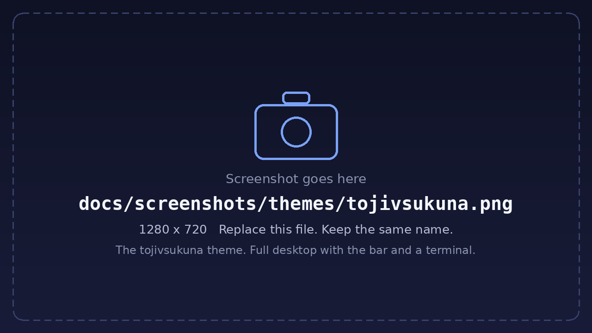</a><br>
      <b>tojivsukuna</b><br>
      <code>hat switch tojivsukuna</code>
    </td> -->
  </tr>
</table>

Want more? Run `hat store list` to see what else you can install. Or [make your own](#make-a-theme). It is easier than you think.

<a id="bars"></a>

## Bars

Love your colors but not your bar? Swap **just the bar**. Click a bar tile in `hat gui` and it uses your current theme's colors.

### Theme Bar Previews

<div align="center">

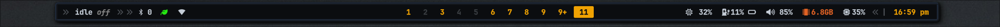<br>
<b>a70</b>

---

<br>
<b>choso</b>

---

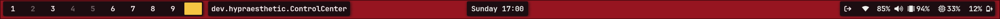<br>
<b>jjk</b>

---

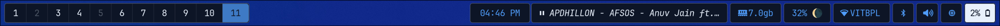<br>
<b>sky</b>

---

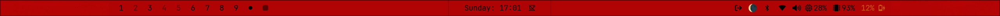<br>
<b>spartan</b>

---

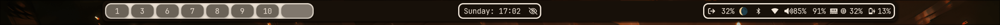<br>
<b>tanjiro</b>

---

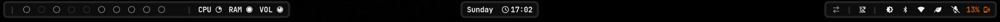<br>
<b>toji</b>

---

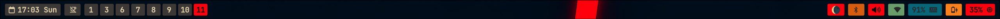<br>
<b>toji_2</b>

</div>

Only want one piece of a theme? Use `hat switch-waybar <theme>` or `hat switch-wallpaper <theme>`.

More bars live in [`layouts/bars/`](layouts/bars). Made in-house: `default`, `compact`, `a70` and `cyberpunk`. The `v*` bars are ported from [HANCORE-linux/waybar-themes](https://github.com/HANCORE-linux/waybar-themes) (MIT).


<a id="control-center"></a>

## Control center

Not a terminal person? Run **`hat gui`** and click around. Every theme is a tile. Click one and your desktop changes. GIF previews even play right inside the tile.

<p align="center">
  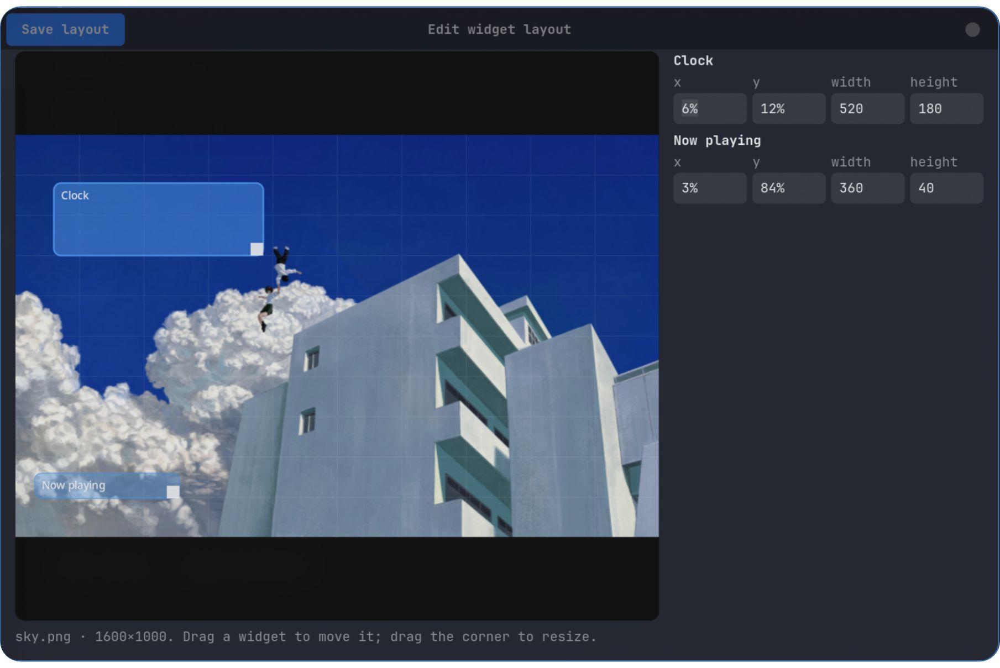
</p>

Eight pages. One clear job each.

<table>
  <tr>
    <td align="center" width="50%">
      <a href="docs/screenshots/gui/presets.png">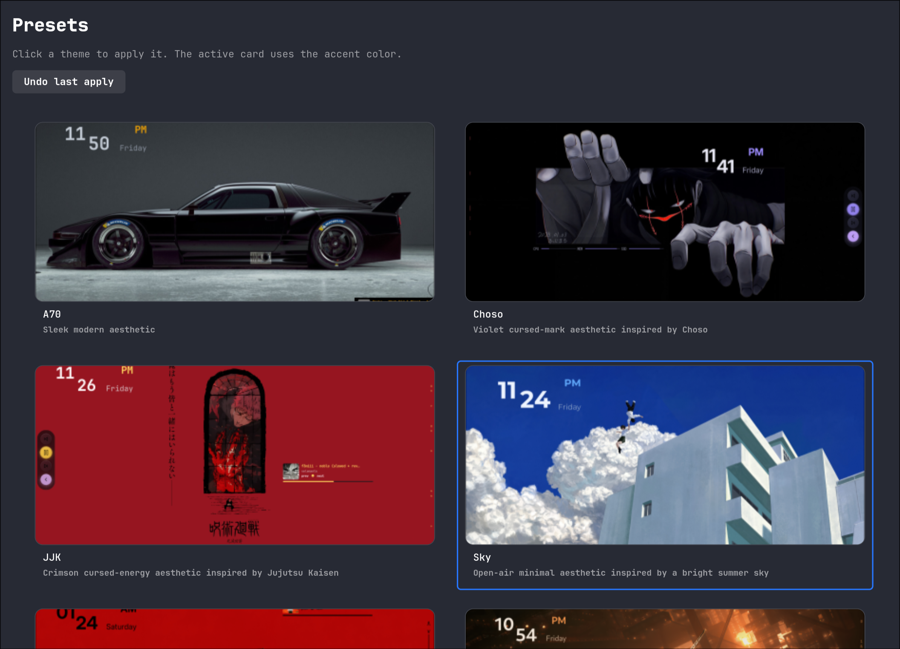</a><br>
      <b>Presets</b><br>
      Theme tiles. Click one and your desktop changes.
    </td>
    <td align="center" width="50%">
      <a href="docs/screenshots/gui/bar.png">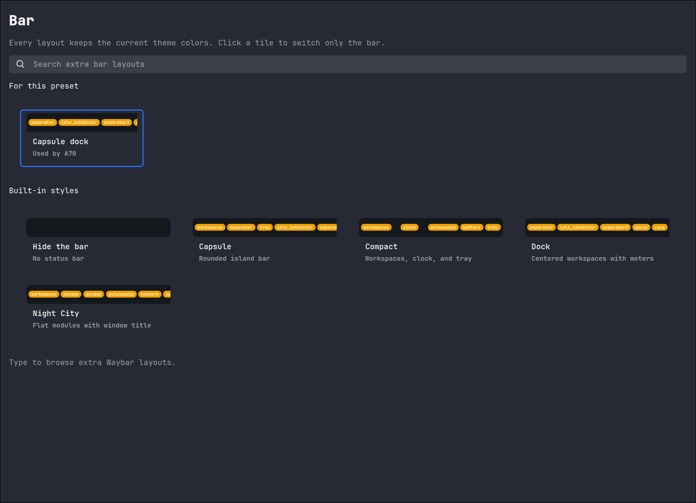</a><br>
      <b>Bar</b><br>
      Pick a bar layout. It uses your current colors.
    </td>
  </tr>
  <tr>
    <td align="center" width="50%">
      <a href="docs/screenshots/gui/widgets.png">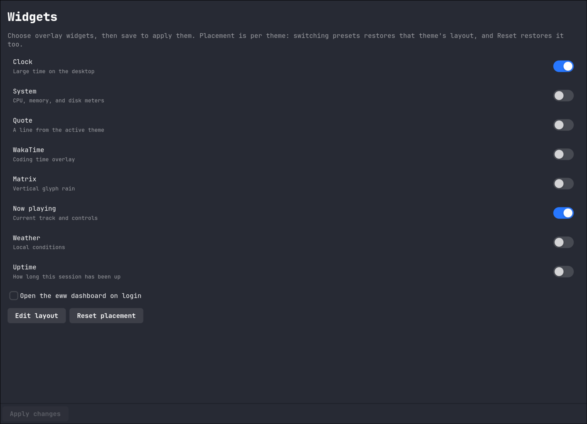</a><br>
      <b>Widgets</b><br>
      Choose your overlays and where they sit.
    </td>
    <td align="center" width="50%">
      <a href="docs/screenshots/gui/fonts.png">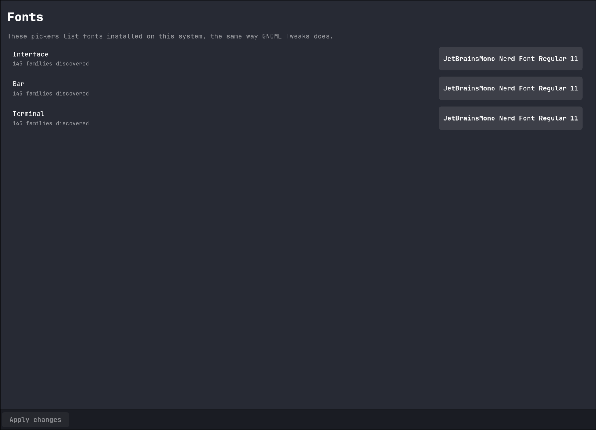</a><br>
      <b>Fonts</b><br>
      Fonts for your apps, your bar and your terminal.
    </td>
  </tr>
  <tr>
    <td align="center" width="50%">
      <a href="docs/screenshots/gui/apps.png">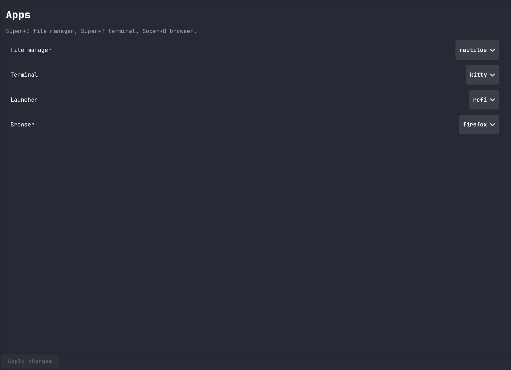</a><br>
      <b>Apps</b><br>
      Your file manager, terminal, browser and launcher.
    </td>
    <td align="center" width="50%">
      <a href="docs/screenshots/gui/look.png">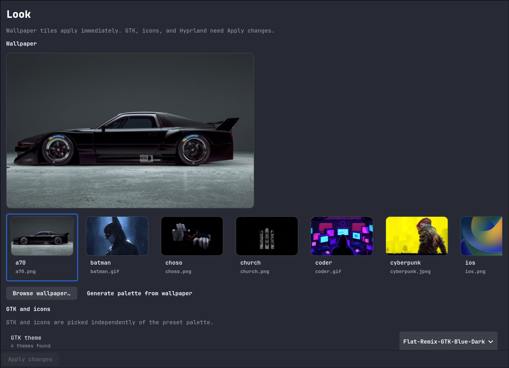</a><br>
      <b>Look</b><br>
      Wallpaper, GTK style, icons and Hyprwave.
    </td>
  </tr>
  <tr>
    <td align="center" width="50%">
      <a href="docs/screenshots/gui/store.png">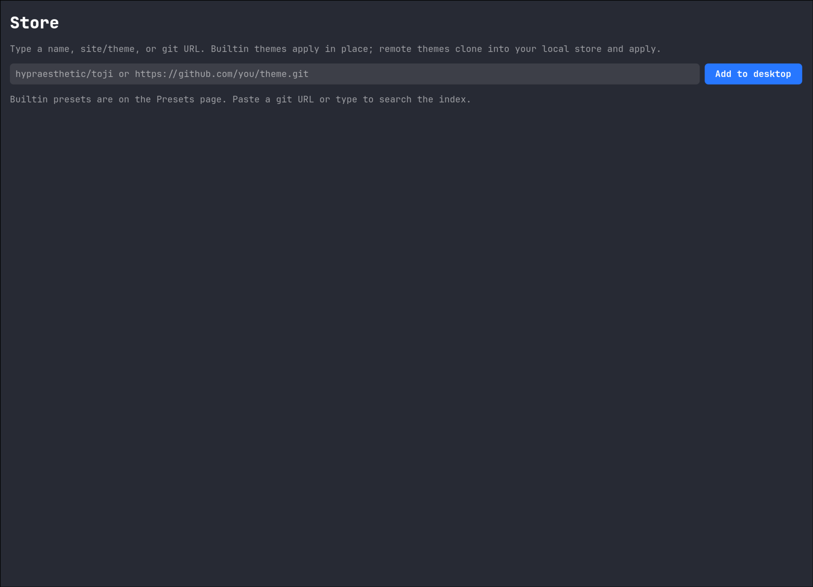</a><br>
      <b>Store</b><br>
      Find and install community themes.
    </td>
    <td align="center" width="50%">
      <a href="docs/screenshots/gui/doctor.png">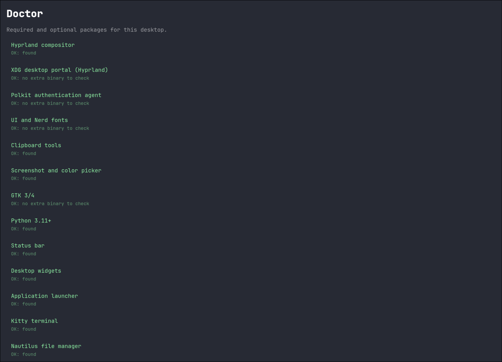</a><br>
      <b>Doctor</b><br>
      Checks that everything you need is installed.
    </td>
  </tr>
</table>

The control center needs GTK4, libadwaita and PyGObject.

<a id="how-it-works"></a>

## How it works

<p align="center">
  
</p>

1. **A theme is a tiny folder.** Inside: a `theme.toml` (your colors), a wallpaper and a preview.
2. **You run one command.** Type `hat switch <theme>`, or click a tile.
3. **Your desktop repaints.** Hyprland, Waybar, eww, Hyprwave, Rofi, Kitty, GTK, Dunst and Neovim all get the new look. That means your windows, bar, widgets, launcher, terminal, notifications, apps and editor all match.

**Why are themes so small?** Layouts are shared by every theme. A theme only brings what is different: colors, a wallpaper and a preview. Need a different bar or widget layout? Add an `overrides/` folder and replace just those files.

**Don't want a piece?** Switch it off per theme. For example, `waybar = false` under `[components]` means that theme won't set up a bar.


<a id="features"></a>

## Everything in the box

<table>
  <tr>
    <td width="33%" valign="top">
      <b>Smart installer</b><br>
      Automatic or Custom. It spots your distro and installs the right packages.
    </td>
    <td width="33%" valign="top">
      <b>Theme packages</b><br>
      Colors, a wallpaper and a preview. That's a whole theme.
    </td>
    <td width="33%" valign="top">
      <b>Control center</b><br>
      Run <code>hat gui</code>. Click a tile. Your desktop changes.
    </td>
  </tr>
  <tr>
    <td width="33%" valign="top">
      <b>A short command</b><br>
      Type <code>hat</code> instead of <code>ha-theme</code>. Same thing, less typing.
    </td>
    <td width="33%" valign="top">
      <b>Live previews</b><br>
      Theme tiles and wallpapers can be GIF, PNG, JPEG or WebP.
    </td>
    <td width="33%" valign="top">
      <b>Widgets per theme</b><br>
      Each theme picks its own widgets. Reset brings back that theme's own layout.
    </td>
  </tr>
  <tr>
    <td width="33%" valign="top">
      <b>Doctor</b><br>
      <code>hat doctor</code> shows what you have and what is missing. Missing extras don't make it fail.
    </td>
    <td width="33%" valign="top">
      <b>Theme store</b><br>
      Search and install community themes with <code>hat store</code>.
    </td>
    <td width="33%" valign="top">
      <b>Safety net</b><br>
      Backups, <code>--dry-run</code> previews and <code>hat restore</code> for when you change your mind.
    </td>
  </tr>
</table>

<a id="cheat-sheet"></a>

## Cheat sheet

`hat` is a short name for `ha-theme`. Use whichever you like.

| Command | What it does |
|---|---|
| `hat gui` | Open the control center |
| `hat list` | List all themes |
| `hat current` | Show the theme you use now |
| `hat switch <theme>` | Switch your whole desktop |
| `hat switch <theme> --dry-run` | Preview the switch. Change nothing. |
| `hat switch-waybar <theme>` | Switch just the bar (`switch-wallpaper` does the wallpaper) |
| `hat doctor` | Check what is installed and what is missing |
| `hat validate [theme]` | Check that a theme is built right |
| `hat backup` and `hat restore` | Save your configs, and bring them back |
| `hat install-theme <folder-or-git-url>` | Add a theme |
| `hat store search <word>` | Find community themes |

Keyboard shortcuts have their own section: [Keybinds](#keybinds).

<details>
<summary><b>Every command</b></summary>

```bash
hat list                                    # all themes
hat current                                 # the theme you use now
hat switch <theme> [--dry-run] [--restart]  # switch everything
hat switch-<component> <theme> [--restart]  # one part only, like switch-waybar
hat validate [theme]                        # check a theme package
hat doctor                                  # check your system
hat backup                                  # save your configs
hat restore [timestamp]                     # bring a backup back
hat menu [--restart]                        # theme picker (Super + A)
hat wallpaper-menu                          # wallpaper picker
hat session-start                           # at each Hyprland login: sets your wallpaper, starts your bar and widgets
hat install [--mode automatic|custom] [--theme NAME] [--yes]
hat install-theme <path-or-git-url>
hat store list | search <query> | install <name-or-url> | refresh [url]
hat prefs get [key]
hat prefs set <key> <value>
hat gui                                     # control center
hat version
```

</details>

<a id="keybinds"></a>

## Keybinds

<kbd>Super</kbd> is your Windows key.

| Keys | What it does |
|---|---|
| <kbd>Super</kbd> + <kbd>A</kbd> | Open the theme picker (same as `hat menu --restart`) |
| <kbd>Super</kbd> + <kbd>W</kbd> | Open `hyprwall` (wallpaper picker) |

### Window Management

| Keys | What it does |
|---|---|
| <kbd>Super</kbd> + <kbd>X</kbd> | Close focused window |
| <kbd>Super</kbd> + <kbd>F</kbd> | Toggle floating |
| <kbd>Super</kbd> + <kbd>Space</kbd> | Toggle fullscreen |
| <kbd>Super</kbd> + <kbd>J</kbd> | Toggle split layout (dwindle) |
| <kbd>Super</kbd> + <kbd>M</kbd> | Open display manager (`hyprdisplay`) |
| <kbd>Super</kbd> + <kbd>P</kbd> | Toggle pseudo-tiled |
| <kbd>Super</kbd> + <kbd>L</kbd> | Lock screen |

### Applications

| Keys | What it does |
|---|---|
| <kbd>Super</kbd> + <kbd>T</kbd> | Open terminal (kitty) |
| <kbd>Super</kbd> + <kbd>E</kbd> | Open file manager (nautilus) |
| <kbd>Super</kbd> + <kbd>B</kbd> | Open browser (firefox) |

### Launcher & Menus

| Keys | What it does |
|---|---|
| <kbd>Super</kbd> + <kbd>R</kbd> | Open app launcher (rofi) |
| <kbd>Alt</kbd> + <kbd>Space</kbd> | Rofi application launcher (drun) |
| <kbd>Super</kbd> + <kbd>A</kbd> | Theme picker (`hat menu --restart`) |

### Clipboard & Tools

| Keys | What it does |
|---|---|
| <kbd>Super</kbd> + <kbd>V</kbd> | Clipboard history (cliphist) |
| <kbd>Super</kbd> + <kbd>Tab</kbd> | Color picker (`hyprpicker`) |
| <kbd>Alt</kbd> + <kbd>S</kbd> | Screenshot region (`hyprshot`) |
| <kbd>Super</kbd> + <kbd>W</kbd> | Wallpaper picker (`hyprwall`) |

### Window Focus & Navigation

| Keys | What it does |
|---|---|
| <kbd>Super</kbd> + <kbd>←/→/↑/↓</kbd> | Focus window in direction |
| <kbd>Super</kbd> + <kbd>1-0</kbd> | Switch to workspace 1-10 |
| <kbd>Super</kbd> + <kbd>Shift</kbd> + <kbd>1-0</kbd> | Move window to workspace 1-10 |
| <kbd>Super</kbd> + <kbd>S</kbd> | Toggle scratchpad (special workspace) |
| <kbd>Super</kbd> + <kbd>Shift</kbd> + <kbd>S</kbd> | Move window to scratchpad |
| <kbd>Super</kbd> + <kbd>Scroll</kbd> | Cycle through workspaces |
| <kbd>Super</kbd> + <kbd>LMB</kbd> | Drag window |
| <kbd>Super</kbd> + <kbd>RMB</kbd> | Resize window |

### Media & Hardware Keys

| Keys | What it does |
|---|---|
| <kbd>XF86AudioRaiseVolume</kbd> | Volume up |
| <kbd>XF86AudioLowerVolume</kbd> | Volume down |
| <kbd>XF86AudioMute</kbd> | Toggle mute |
| <kbd>XF86AudioMicMute</kbd> | Toggle mic mute |
| <kbd>XF86MonBrightnessUp</kbd> | Brightness up |
| <kbd>XF86MonBrightnessDown</kbd> | Brightness down |
| <kbd>XF86AudioNext</kbd> | Next track |
| <kbd>XF86AudioPrev</kbd> | Previous track |
| <kbd>XF86AudioPlay/Pause</kbd> | Play/Pause toggle |

### Power & Session

| Keys | What it does |
|---|---|
| <kbd>Lid Close</kbd> | Suspend system |

---

**Want your own keybinds?** Put them in `~/.config/hypr/custom.lua`. HyprAesthetic creates that file once, only if it is missing, and never touches it again. Switching themes will not overwrite your binds.


<a id="make-a-theme"></a>

## Make your own theme

A theme is a small folder. You don't copy a 200-file rice just to try new colors.

<p align="center">
  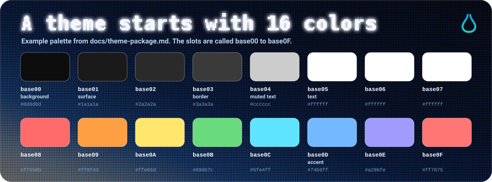
</p>

**1. Make the folder.**

```text
themes/mytheme/
├── theme.toml       # required: your 16 colors and settings
├── preview.png      # shows in the control center (or preview.gif)
├── wallpaper.jpg    # jpg, png, gif or webp
├── assets/          # optional: character art, quotes
└── overrides/       # optional: only if you want a different layout
    ├── waybar/style.css
    └── eww/eww.yuck
```

**2. Fill in `theme.toml`.** Here is a full example. The name must match the folder name.

<details>
<summary><b>📄 See a full theme.toml</b></summary>

```toml
schema = 2
name = "mytheme"                 # must match the folder name
display_name = "My Theme"
description = "One line"
author = "you"
version = "1.0.0"
license = "MIT"
min_hypraesthetic = "0.2.0"
preview = "preview.png"
source = "https://github.com/you/mytheme.git"  # optional, for the store

[misc]
wallpaper = "mytheme.png"
hw_theme = "octane"              # hyprwave CSS name, if you use one

[palette]
base00 = "#0d0d0d"               # background
base01 = "#1a1a1a"               # surface
base02 = "#2a2a2a"
base03 = "#3a3a3a"               # border
base04 = "#cccccc"               # muted text
base05 = "#ffffff"               # text
base06 = "#ffffff"
base07 = "#ffffff"
base08 = "#ff6b6b"
base09 = "#ff9f43"
base0A = "#ffe66d"
base0B = "#69db7c"
base0C = "#5fe4ff"
base0D = "#74b9ff"               # accent
base0E = "#a29bfe"
base0F = "#ff7675"

[colors.hyprland]
border_active = "{{palette.base0D}}"
border_inactive = "{{palette.base03}}"
shadow = "{{palette.base00}}aa"

[colors.waybar]
background = "{{palette.base00}}"
foreground = "{{palette.base05}}"
primary = "{{palette.base0D}}"
# omitted keys fill from the palette

[colors.eww]
background = "{{palette.base00}}"
foreground = "{{palette.base05}}"

[layout]
bar = "waybar"
launcher = "rofi"
widgets = ["clock", "system", "matrix", "wakatime", "toji"]

[defaults]
file_manager = "nautilus"
terminal = "kitty"

[components]
hyprland = true
waybar = true
hyprwave = true
eww = true
rofi = true
kitty = true
gtk = true
dunst = true
nvim = true
```

The full spec is in [`docs/theme-package.md`](docs/theme-package.md).

</details>

**3. Check it, then try it.**

```bash
hat validate mytheme
hat switch mytheme --dry-run
hat switch mytheme
```

**4. Share it.** Put your theme in a git repo, with `theme.toml` at the top. Now anyone can add it:

```bash
hat install-theme https://github.com/you/mytheme.git
hat switch mytheme
```

Want it in the store too? Add it to [`data/store-index.toml`](data/store-index.toml). It will then show up in `hat store list` and on the control center's Store page. The details are in [`docs/store.md`](docs/store.md) and [`ADDING_THEMES.md`](ADDING_THEMES.md).

> [!TIP]
> GIF previews bigger than 8 MB (or 8 million pixels) only show their first frame in the control center. Keep them small and they will move.

<a id="settings"></a>

## Your settings

| File | What it is |
|---|---|
| `~/.config/HyprAesthetic/prefs.toml` | HyprAesthetic's own settings. Read and change them with `hat prefs get` and `hat prefs set`. |
| `~/.config/hypr/custom.lua` | **Your** keybinds and monitor setup. It is copied once if it is missing. Switching themes never touches it again. |
| `~/.config/hypr/hypraesthetic-apps.lua` | Your default apps. Shared by every theme. |

<a id="faq"></a>

## FAQ

<details>
<summary><b>Does it work with Sway, GNOME or KDE?</b></summary>

<br>

No. HyprAesthetic is for **Hyprland only**.

</details>

<details>
<summary><b>Will it mess up my current setup?</b></summary>

<br>

The installer backs up your config folders first, and `hat restore` brings them back. You can also run `hat switch <theme> --dry-run` to see what would change before you commit.

</details>

<details>
<summary><b>Which Linux distros work?</b></summary>

<br>

The Arch family, Fedora (including Asahi), Ubuntu and Debian, openSUSE, and NixOS. The package names for each are in [`data/packages.toml`](data/packages.toml).

</details>

<details>
<summary><b>I don't know Python. Can I still use it?</b></summary>

<br>

Yes. You never need to touch the Python. Use the control center, or type a command.

</details>

<details>
<summary><b>Can I keep my own keybinds and monitor setup?</b></summary>

<br>

Yes. Put them in `~/.config/hypr/custom.lua`. HyprAesthetic copies that file once if it is missing, and it never overwrites it after that.

</details>

<details>
<summary><b>Can I use my own wallpaper?</b></summary>

<br>

Yes. Drop it in `~/.wallpapers`, then name it under `[misc]` in your theme's `theme.toml`.

</details>

<details>
<summary><b>My distro has no package for eww or Hyprwave.</b></summary>

<br>

That is fine. They are optional on those distros. Run `hat doctor` to see what is missing and what is optional.

</details>

<details>
<summary><b>Something looks wrong. What now?</b></summary>

<br>

Run `hat doctor` and `hat validate <theme>`. If it still looks wrong, [open an issue](https://github.com/TheLinuxGuy-ssh/HyprAesthetic/issues) and paste what they say.

</details>

<details>
<summary><b>Is it free?</b></summary>

<br>

Yes. It uses the MIT license. Use it, change it, share it.

</details>

<details>
<summary><b>🛠️ For developers</b></summary>

<br>

You need Python 3.11 or newer.

```bash
# run the tests
PYTHONPATH=src python3 -m unittest discover -s tests -v

# run the same checks CI runs
bash scripts/ci/run-checks.sh
```

Where things live:

| Folder | What is inside |
|---|---|
| `src/hypraesthetic/` | The main code |
| `src/hypraesthetic_gui/` | The GTK4 control center |
| `themes/` | The themes that ship with the project |
| `layouts/` | Shared layouts, including `layouts/default/` and every bar in `layouts/bars/` |
| `data/` | Package names per distro and the theme store index |
| `docs/` | Docs for theme packages and the store |
| `scripts/` | Helper scripts, including the CI checks |
| `tests/` | The test suite |

The entry point is the `ha-theme` file in the repo root. See the [changelog](CHANGELOG.md) for what changed and when.

</details>

<!--
  🗺️ ROADMAP (optional)
  A live roadmap gives people a reason to come back. Fill in 3 to 5 real plans, then remove this comment.

  ## 🗺️ What's next

  - [x] Installer, theme packages, control center and theme store
  - [ ] your next big idea
  - [ ] another one
-->


<a id="contribute"></a>

## Join in

<table>
  <tr>
    <td width="25%" valign="top">
      <b>Star the repo</b><br>
      The easiest way to help. It also helps other people find this project.
    </td>
    <td width="25%" valign="top">
      <b>Add a theme</b><br>
      Follow the <a href="ADDING_THEMES.md">guide</a>, then open a pull request.
    </td>
    <td width="25%" valign="top">
      <b>Report a bug</b><br>
      Run <code>hat doctor</code> first, then <a href="https://github.com/TheLinuxGuy-ssh/HyprAesthetic/issues">open an issue</a> with what it says.
    </td>
    <td width="25%" valign="top">
      <b>Show your desktop</b><br>
      Post a screenshot in an issue. Tell us which theme you used.
    </td>
  </tr>
</table>

Before you start, please read [CONTRIBUTING.md](CONTRIBUTING.md) and the [Code of Conduct](CODE_OF_CONDUCT.md). Need help? See [SUPPORT.md](SUPPORT.md).

Found a security problem? Please **don't** open a public issue. Follow [SECURITY.md](SECURITY.md) instead.

## Thanks

- The `v*` bars come from [HANCORE-linux/waybar-themes](https://github.com/HANCORE-linux/waybar-themes) (MIT).
- [Hyprland](https://github.com/hyprwm/Hyprland), for making Linux desktops fun again.
<!-- ✏️ Wallpaper and art credits: list the artists or sources here. -->

## License

MIT. See [LICENSE](LICENSE).

<!--
  ⭐ STAR HISTORY CHART
  Uncomment this when the repo has 20 or more stars. An empty chart looks sad.

<p align="center">
  <a href="https://star-history.com/#TheLinuxGuy-ssh/HyprAesthetic&Date">
    
  </a>
</p>
-->


<div align="center">

### If HyprAesthetic saved you an evening, a star helps other people find it.

Made with 💜 for people who love pretty desktops.

<sub><a href="#">↑ Back to top</a> &nbsp;·&nbsp; <a href="CHANGELOG.md">Changelog</a> &nbsp;·&nbsp; <a href="LICENSE">MIT License</a></sub>

</div>