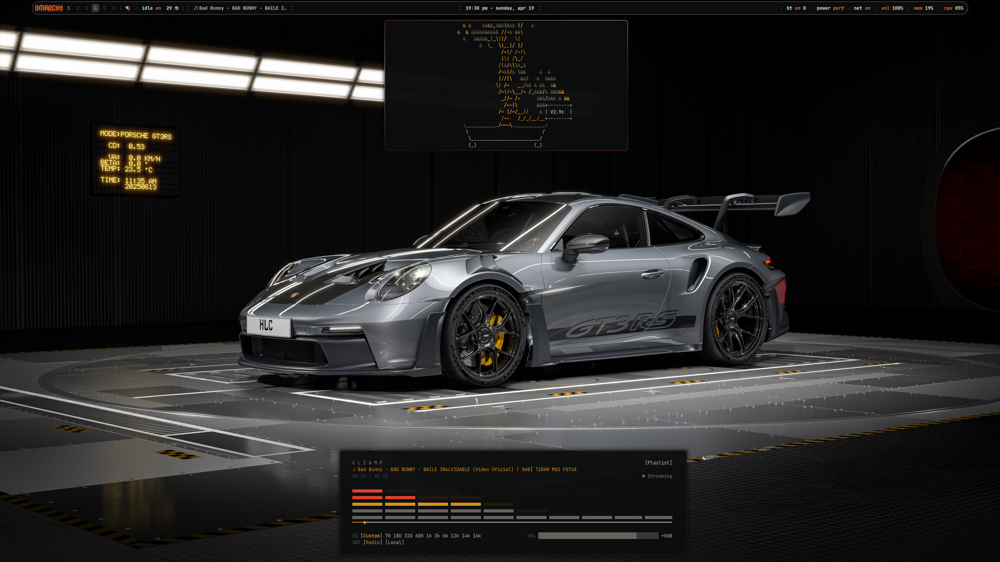
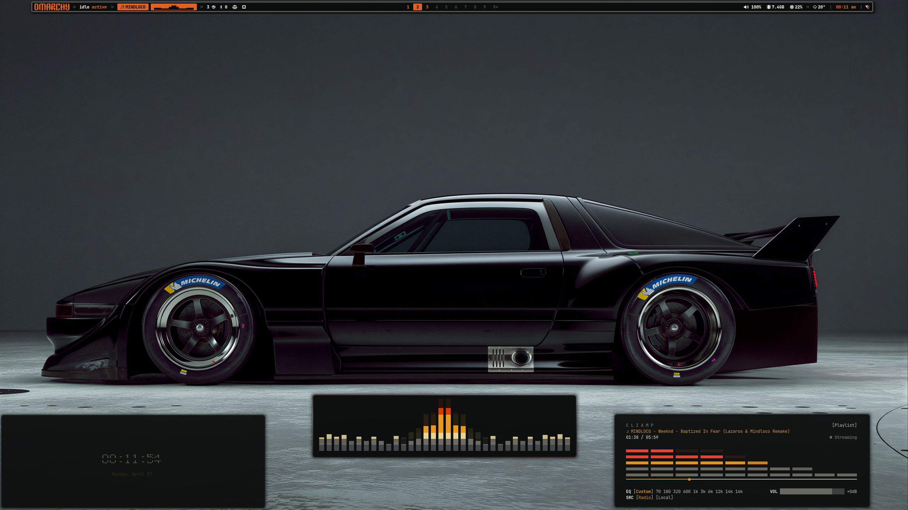
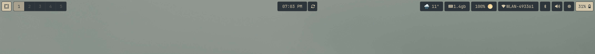
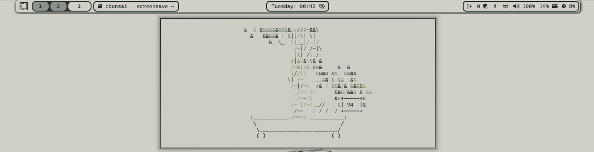
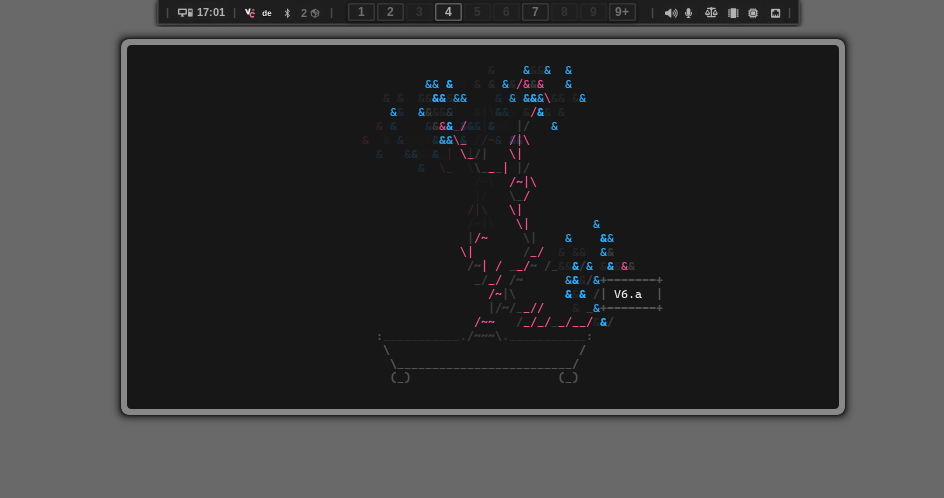

<div align="center">


# HyprAesthetic

Hyprland rice: installer, theme packages, and a GTK control center. One command to switch the desktop. Hyprland only.

[](LICENSE)
[](https://www.python.org/downloads/)
[](https://github.com/TheLinuxGuy-ssh/HyprAesthetic/actions)

<br>

<a href="#installation"><kbd> <br> Install <br> </kbd></a>&ensp;
<a href="#usage"><kbd> <br> CLI <br> </kbd></a>&ensp;
<a href="#gallery"><kbd> <br> Gallery <br> </kbd></a>&ensp;
<a href="#creating-themes"><kbd> <br> Themes <br> </kbd></a>&ensp;
<a href="#contributing"><kbd> <br> Contribute <br> </kbd></a>&ensp;
<a href="LICENSE"><kbd> <br> License <br> </kbd></a>

</div>

## Gallery

Desktops and bars that ship in this repo. Click a bar tile in `hat gui` to apply that layout on the current theme colors.

<div align="center">
<table>
<tr><td align="center">Island bar</td><td align="center">Thin bar + widgets</td></tr>
<tr>
<td></td>
<td></td>
</tr>
</table>
</div>

<div align="center">
<table>
<tr><td align="center">v7</td><td align="center">v4</td><td align="center">v6.a</td></tr>
<tr>
<td></td>
<td></td>
<td></td>
</tr>
</table>
</div>

<p align="center">

</p>

More layouts live under [`layouts/bars/`](layouts/bars/). First-party: `default`, `compact`, `a70`, `cyberpunk`. The `v*` set is ported from [HANCORE-linux/waybar-themes](https://github.com/HANCORE-linux/waybar-themes) (MIT).

## Features

- **Installer** — Automatic (Hyprland, Waybar, widgets, Kitty, Nautilus, project fonts) or Custom (pick bar, widgets, file manager, terminal).
- **Theme packages** — `theme.toml` palette. Optional `overrides/` only when a theme needs a different layout than `layouts/default/`.
- **Control center** — `hat gui` (GTK4 / libadwaita).
- **CLI** — `ha-theme` and `hat` in `~/.local/bin`.
- **Previews** — GIF, PNG, JPEG, WebP for theme tiles and wallpapers.
- **Per-theme widgets** — `[layout].widgets` in the package. Reset restores that theme's placement.
- **Doctor** — `hat doctor` lists required and optional programs. Optional gaps do not fail the report.

## Installation

```bash
git clone https://github.com/TheLinuxGuy-ssh/HyprAesthetic.git ~/.local/share/HyprAesthetic
cd ~/.local/share/HyprAesthetic
./install.sh
```

A normal user with sudo is recommended; running as root prints a warning and asks before continuing.

Automatic or Custom. Packages for the detected distro. Backup of managed dirs (`hypr`, `waybar`, `hyprwave`, `eww`, `rofi`, `kitty`, `gtk-3.0`, `gtk-4.0`, `dunst`, `nvim`). Theme apply. `prefs.toml`. Links `ha-theme`, `hat`, `hyprwall` into `~/.local/bin`.

Custom without `--yes` asks before packages. Declining (or no TTY) skips packages and reports an incomplete install.

First-time compositor: log out and pick **Hyprland**.

## Usage

`hat` is `exec ha-theme "$@"`.

```bash
hat list
hat current
hat switch <theme> [--dry-run] [--restart]
hat switch-<component> <theme> [--restart]
hat validate [theme]
hat doctor
hat backup
hat restore [timestamp]
hat menu [--restart]
hat wallpaper-menu
hat session-start
hat install [--mode automatic|custom] [--theme NAME] [--yes]
hat install-theme <path-or-git-url>
hat store list | search <query> | install <name-or-url> | refresh [url]
hat prefs get [key]
hat prefs set <key> <value>
hat gui
hat version
```

`switch-waybar` / `switch-wallpaper` apply one component. Super+A is the theme picker (`hat menu --restart`). Super+W is `hyprwall`. `session-start` runs once per Hyprland login: wallpaper always; cliphist if both binaries exist; Waybar / eww / Hyprwave from prefs.

## Control center

`hat gui` needs GTK4, libadwaita, and PyGObject.

| Page | |
| --- | --- |
| Presets | Theme tiles. Click applies. |
| Bar | Waybar layout, current palette. |
| Widgets | Overlays and placement. |
| Fonts | UI, bar, terminal. |
| Apps | File manager, terminal, browser, launcher. |
| Look | Wallpaper, GTK, icons, Hyprwave. |
| Store | Search / install themes. |
| Doctor | Package checks. |

Tiles load through GdkPixbuf. Animated GIFs play in-tile unless the file is static, larger than 8 MB, or larger than 8 million pixels (first frame only).

## Components

Apply writes Hyprland, Waybar, eww, Hyprwave, Rofi, Kitty, GTK, Dunst, and Neovim when `[components]` leaves them on. Default apps are `~/.config/hypr/hypraesthetic-apps.lua`, not a per-theme copy.

## Creating Themes

[ADDING_THEMES.md](ADDING_THEMES.md) · [docs/theme-package.md](docs/theme-package.md)

Shipped in `themes/`: **toji**, **toji_2**, **a70**, **cyberpunk**, **choso**, **jjk**, **sky**, **tanjiro**, **tojivsukuna**.

```text
mytheme/
  theme.toml
  preview.gif     # or preview.png
  wallpaper.gif   # or wallpaper.jpg
```

Layouts: `layouts/default/`. Add `overrides/` only to replace those files.

## Configuration

`~/.config/HyprAesthetic/prefs.toml` — `hat prefs get` / `hat prefs set`.

`~/.config/hypr/custom.lua` — keybinds and monitors. Copied once if missing; later switches leave it alone.

## Distros

Arch family, Fedora (including Asahi), Ubuntu/Debian, openSUSE, NixOS. Names in [data/packages.toml](data/packages.toml). Hyprwave and eww are optional when the distro has no package.

## Development

Python 3.11+.

```bash
PYTHONPATH=src python3 -m unittest discover -s tests -v
bash scripts/ci/run-checks.sh
```

Code: `src/hypraesthetic/`, `src/hypraesthetic_gui/`. Entry: `ha-theme`.

## Contributing

[CONTRIBUTING.md](CONTRIBUTING.md) · [Code of Conduct](CODE_OF_CONDUCT.md)

## Security

[SECURITY.md](SECURITY.md). Private GitHub advisory or the maintainer email there. Not a public issue.

## License

MIT. [LICENSE](LICENSE).
